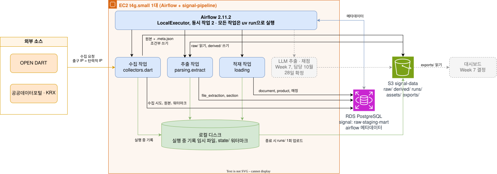

# 파이프라인 아키텍처 초안

처리 흐름이 저장 계층(signal-infra `docs/storage-design.md`) 위에서 어떻게 실행되는지를 정한다. 실행 단위와 DAG, 단계별 입출력 위치, 실행 환경, 인프라 결정 6건에 대한 의견을 담는다.

## 상태

| 항목 | 내용 |
|---|---|
| 상태 | 초안. PM(대현) 리뷰 반영(10월 29일). 인프라 결정 6건·Airflow 2.11.2는 PM 동의(10월 25일 리뷰) |
| 작성 | 데이터 엔지니어링·인프라(주영), 10월 22일 |
| 입력 | 저장 계층 설계(signal-infra `docs/storage-design.md`, 10월 19일 병합), [원본 보관과 수집·파싱 실패 처리 규칙](storage-and-failure-rules.md)·ERD v2.2(`dev`), [2단계 데이터 파이프라인 Flow 설계 입력](pipeline-flow.md)(9월 30일 초안), 크롤러(PR #47)·추출기(PR #51)·로컬 DDL(PR #59)·적재(PR #63) 코드 |
| 정하는 것 | 처리 흐름이 저장 계층 위에서 어떻게 실행되는가: 실행 단위와 DAG, 단계별 입출력 위치, 실행 환경, 인프라 결정 6건에 대한 의견 |
| 정하지 않는 것 | 저장 계층(S3 트리·보관·권한·비용: 저장 계층 설계에서 확정), 채점 산식(CDI 담당), 추출 모듈·점수 계산·축 4 판정·통합 실행의 담당(10월 31일 미팅에서 PM 확정 예정) |
| 다음 단계 | 11차 미팅 안건 6 인프라 결정, Week 7 구축 체크리스트. 완성 Flow 설계(ERD v2.2 표별 쓰기 주체·Airflow 작업 흐름도 상세)는 11월 4일 |

## 1. 한 장 그림

저장 계층 설계 5절 구성 그림 위에 처리 흐름을 겹친 것. 상자는 실행 주체, 화살표는 데이터 이동.

- 그림 원본은 draw.io. SVG 파일에 편집 원본이 들어 있어 draw.io로 열어 고칠 수 있음
- 그림에서 저장 계층 설계와 다른 곳은 없음. 추가한 것은 EC2 안의 작업 상자 4개와 로컬 디스크, 화살표의 표 이름
- 금투협·금감원은 그리지 않음: 금감원 정기 수집은 보류(11차 미팅 안건 2), 금투협 Phase 1 포함은 결정 대기 D

## 2. 실행 단위와 DAG 구성

### 2-1. 실행(run)과 DAG run의 대응

| 실행 종류 | DAG | DAG run 1회 = | `run_id` 발급 | 실행 폴더 |
|---|---|---|---|---|
| EXTRACT | `signal_extract` (주간) | 수집 → 추출 → 적재 한 번 | DAG 시작 작업에서 1개 발급해 뒤 작업에 넘김 | `runs/{run_id}/` 1개 |
| SCORE | `signal_score` (수동 또는 EXTRACT 완료 뒤) | 채점 입력 생성 → 채점 → 게시 | 채점 DAG 시작 작업에서 발급. `upstream_run_id`에 EXTRACT run 기록 | `runs/{score_run_id}/` 1개 |

- DAG 2개로 두는 이유: ERD의 실행 종류가 EXTRACT·SCORE 2종이고, 원본 보관 규칙이 실행 폴더를 `runs/{run_id}/` 하나로 완료 뒤 불변으로 둠. 소스별로 DAG를 나누면 실행 하나를 여러 DAG가 나눠 쓰게 되어 이 규칙과 어긋남
- 소스별 병렬: 수집 DAG 안에서 소스마다 작업을 두고 Airflow가 동시 작업 2 안에서 병렬 실행. 소스 추가는 작업 추가

### 2-2. 지금 코드와의 차이 (적용 때 바꿀 것)

| 항목 | 지금 코드 | 이 설계 | 바꾸는 시점 |
|---|---|---|---|
| `run_id` 발급 | 크롤러(`collectors.dart`)와 추출기(`parsing.extract`)가 각자 `RunLog`로 발급. 적재(PR #63)는 추출 실행 폴더를 읽음 | DAG 시작 작업이 발급한 `run_id`를 환경 변수로 각 작업에 전달. `RunLog`는 `run_id` 인자를 이미 받지만 폴더를 새로 만들고(`exist_ok=False`) `run.json`을 새로 쓰므로, 시작 작업만 폴더·`run.json`을 만들고 후속 작업은 기존 실행을 열어 재생성하지 않는 경로를 추가 | Week 7 DAG 작성 때 |
| 워터마크 | 로컬 파일 `state/{source}.json` | ERD `source_watermark` 표. 로컬 파일은 DB 가동 전 임시 | DB 구축 뒤 적재 스크립트 전환 때 |
| 수집 기록 순서 | 원본 저장 뒤 `attempts.jsonl` 한 줄 | 시작 행(`outcome = STARTED`) 기록 → 결과 갱신(적재 순서 1·5) | DB 적재 구현 때(PR #47 리뷰 합의) |
| 적재 입력 | 추출 실행의 `extraction_attempts.jsonl` 파일 | 같음. DAG에서는 같은 run의 파일을 읽으므로 `--run-id` 지정 불필요 | 변경 없음 |
| 적재 방식 | PR #63 로컬 적재: 4개 표를 `TRUNCATE` 뒤 다시 넣는 일회성 기준선 | DAG 적재는 upsert. `file_extraction`은 EXTRACT_OK 재사용, FAILED·PARTIAL은 같은 키 행을 덮어씀(원본 보관 규칙 「버전·중복·재추출」 3) | Week 7 DAG 작성 때 |

### 2-3. 작업 실행 방식

- 모든 작업은 BashOperator로 `uv run python -m signal_pipeline.<모듈>`을 실행. 근거: Airflow 제약 파일과 `uv.lock`이 8개 패키지에서 충돌(10월 18일 확인)해 환경을 분리함(저장 계층 설계 6절 10)
- Airflow는 작업의 종료 코드만 봄. 크롤러는 실패 시 종료 코드 1(PR #47), 추출기·적재도 같은 규칙을 따름
- 작업에 넘기는 값: `RAW_ROOT`, `DATABASE_URL`, `RUN_ID`, `EXTRACT_WORKERS`(2). 비밀값은 SSM Parameter Store에서 읽어 환경 변수로(저장 계층 설계 3.8)
- 동시 작업 수 2(저장 계층 설계 3.3). 추출기 안의 파일 병렬(`EXTRACT_WORKERS`)도 2라, 추출 작업 하나가 CPU 2개를 다 씀
- DAG 의존 순서는 같은 DAG run 안만 막음. 두 DAG와 여러 DAG run이 겹치지 않도록 다음을 둠([Airflow 2.11 Pools](https://airflow.apache.org/docs/apache-airflow/2.11.0/administration-and-deployment/pools.html))
  - 공유 pool `signal_cpu`(슬롯 2). 두 DAG의 모든 작업이 이 pool을 씀. 추출 작업은 `pool_slots=2`로 2슬롯을 다 차지해 다른 작업과 겹치지 않음
  - DAG마다 `max_active_runs=1`

### 2-4. 실행 기록 업로드와 실패·재실행

- 실행 중 기록(`run.json`, `attempts.jsonl`, `extraction_attempts.jsonl`)은 EC2 로컬 디스크에 쓰고, DAG 끝 작업이 `runs/{run_id}/`에 한 번 올림(원본 보관 규칙 「실행 폴더 불변」)
- 작업이 실패로 끝날 때도 그때까지의 기록을 올리는 정리 작업을 둠(Airflow `trigger_rule=all_done`). 원본 보관 규칙 「실행 폴더 불변」의 「실행이 끝날 때」에 실패로 끝난 실행도 포함한다고 해석함(규칙 개정 없음, 10월 25일 PM(대현) 리뷰). 이유: 로컬 기록은 EBS 볼륨이라 EC2가 멈춰도 남지만, 올리지 않으면 `runs/`에서 실패 실행을 볼 수 없음. `runs/`는 조건부 쓰기라 같은 키를 다시 쓸 수 없으므로, 실패 실행은 `run.json`의 상태를 FAILED로 둔 채 올리고 재실행은 새 `run_id`로 함
- DAG run 상태: Airflow 2.11은 마지막 작업들의 상태로 DAG run 상태를 정하므로, 정리 작업이 성공하면 상위 작업이 실패해도 DAG run이 success가 됨([Airflow 2.11 DAG Runs](https://airflow.apache.org/docs/apache-airflow/2.11.0/core-concepts/dag-run.html)). 정리 작업은 업로드 뒤 상위 작업에 실패가 있으면 종료 코드 1로 끝남. 상위 상태는 Airflow 템플릿 `dag_run`으로 bash 명령에 넘김(Week 7 시험 DAG에서 확인)
- 정리 작업이 돌지 못한 경우(OOM, 예산 중지): `pipeline_run`이 RUNNING으로 남음. 다음 실행의 시작 작업이 같은 종류의 RUNNING 실행을 FAILED로 마감하고, 로컬 실행 폴더가 남아 있으면 `runs/{run_id}/`에 올림. `max_active_runs=1`이라 그 시점에 같은 종류의 실행이 실제로 돌고 있을 수 없음
- 재실행: 수집은 워터마크가 멈춘 날부터 다시 받음(데이터 처리 요구 명세 8절 공통 규칙). 추출은 같은 파일 × 파서 버전의 EXTRACT_OK를 건너뜀. 채점은 새 `score_run_id`. 세 경우 모두 이미 있는 코드 동작과 같음
- 중단 시(EC2 예산 중지 등): 수집 시작 행(`outcome = STARTED`)이 결과 없이 남아 재시도 분모에 잡힘(적재 순서 1·5의 의도). 지금 크롤러는 시작 행을 쓰지 않아 중단된 시도가 기록에 없음(2-2)

## 3. 단계별 데이터 흐름

적재 순서(원본 보관 규칙 「적재 순서」 1~11)를 DAG 작업 단위로 나눈 것. 「지금 코드」는 PR #47·#51·#63 기준이고, 「설계」와 다른 칸은 2-2에서 바꾸는 시점을 정함.

### 3-1. EXTRACT DAG (`signal_extract`)

| 순서 | 작업 | 입력 | 출력(S3) | 출력(RDS) | 실패 처리 | 지금 코드 |
|---|---|---|---|---|---|---|
| 0 | 실행 시작 | 스케줄(주간) | `runs/{run_id}/run.json`(로컬, 끝에 업로드) | `raw.pipeline_run` 1행(EXTRACT, RUNNING) | 같은 종류의 RUNNING 실행이 남아 있으면 FAILED로 마감(2-4) | 각 모듈이 따로 발급(2-2) |
| 1 | 수집(소스마다 작업 1개) | `source_watermark`, 외부 API | `raw/{source}/…` 원본 + `.meta.json`(조건부 쓰기), 목록 응답 `raw/dart/_list/…` | `raw.collection_attempt`(시작 행 `STARTED` → 결과 갱신), `raw.raw_object`, `raw.source_watermark` 전진 | 재시도 가능 실패면 그날 미완료, 워터마크 정지, 실행 FAILED(종료 코드 1). 영구 실패·014는 완료를 막지 않음 | DART만. 로컬 폴더·`state/dart.json`·`attempts.jsonl` |
| 2 | 추출·절 분할 | `raw/` 본문 PDF(접수번호별 최신 판) | `derived/{raw_sha256}/{parser_version}/text.txt`·`structure.json` | `staging.file_extraction`, `staging.section` | 파일 단위 격리. EXTRACT_OK 재사용. FAILED·PARTIAL은 다음 실행이 같은 키 행을 덮어씀. 표 분리만 실패한 결과는 예외로 재추출(원본 보관 규칙 「버전·중복·재추출」 3). 300초 초과는 EXTRACT_FAILED | 로컬 폴더. DB 행은 PR #63 적재가 만듦 |
| 3 | 등록·매칭 | 목록 응답, `raw_object` | 없음 | `raw.document`, `staging.product`, `staging.document_product`, `staging.fund_group`, `staging.match_failure` | 매칭 실패는 `match_failure`에 기록, 실행은 계속. 끝에 `db/checks/document_distributor.sql` 실행, 1행 이상이면 실행 FAILED | PR #63이 `document`·`raw_object`·`file_extraction`·`section`만 적재. 매칭은 미구현 |
| 4 | 실행 마감 | 로컬 기록 파일 | `runs/{run_id}/extraction_attempts.jsonl`·`attempts.jsonl`·`run.json` 1회 업로드 | `raw.pipeline_run` 상태 SUCCEEDED/FAILED | 상위 작업이 실패해도 실행(`trigger_rule=all_done`). 업로드 뒤 상위 실패가 있으면 종료 코드 1(2-4) | 없음 |

- 작업 2와 3의 순서: 지금 PR #63은 추출 결과 파일을 읽어 4개 표를 한 번에 적재하므로 「추출 → 적재」가 맞음. 매칭이 구현되면 등록(`document`·`product`)은 추출보다 먼저 올 수 있음. 이 초안은 지금 코드 순서를 따름
- 작업 1의 소스별 병렬은 동시 작업 2 안에서 Airflow가 배분. 추출 작업(파일 병렬 2)은 공유 pool 2슬롯을 차지해 다른 작업과 겹치지 않음(2-3)
- 로컬 적재(PR #63)는 기준선용 일회성 `TRUNCATE` 재적재. 작업 2·3의 DAG 적재는 Week 7에 upsert로 새로 만듦(2-2)

### 3-2. SCORE DAG (`signal_score`)

| 순서 | 작업 | 입력 | 출력(S3) | 출력(RDS) | 비고 |
|---|---|---|---|---|---|
| 0 | 실행 시작 | 수동 트리거 또는 EXTRACT 완료 | `runs/{score_run_id}/run.json` | `raw.pipeline_run`(SCORE, RUNNING, `upstream_run_id`) | |
| 1 | LLM 6필드 추출 | `section`, `derived/text.txt` | `runs/{run_id}/llm/{document_id}/{field}/attempt-{n}/request.json`·`response.json` | `staging.llm_field_extraction`(`input_sha256`로 재호출 생략) | 담당·시작일은 10월 31일 미팅에서 확정 예정. EXTRACT DAG에 둘지 여기 둘지는 그때 정함 |
| 2 | 채점 입력 생성 | `fund_group`, `section`, `derived/` | `runs/{score_run_id}/inputs.json`·`selection.json`·`documents.parquet`·`excluded.parquet` | 없음 | [데이터 처리 요구 명세](processing-requirements.md) 2절. 시작 때 한 번 쓰고 불변 |
| 3 | 채점 | 채점 입력 파일 | `runs/{score_run_id}/populations/…` | `mart.score`, `mart.population_snapshot` | 산식은 CDI 담당. 구현 담당은 10월 31일 미팅에서 확정 예정 |
| 4 | 게시 | `mart.score` | `exports/runs/{score_run_id}/scores.parquet`·`sensitivity/`·`dashboard_documents.parquet` | 없음 | 공식 지정은 작업 6. 대시보드 연결 Week 7 결정 |
| 5 | 실행 마감 | 로컬 기록 | `runs/{score_run_id}/run.json` 등 남은 기록 업로드 | `raw.pipeline_run` SUCCEEDED/FAILED | SUCCEEDED로 바꾸기 전 실행 폴더 파일 sha256 재대조(원본 보관 규칙 「실행 폴더 불변」). 실패 처리는 EXTRACT 작업 4와 같음 |
| 6 | 공식 지정(수동, DAG 밖) | SUCCEEDED인 SCORE 실행, PM 승인 | `exports/official.json` | `raw.pipeline_run.is_official`·`published_at` 전환(이전 공식 해제) | SUCCEEDED인 SCORE 실행만([데이터 테이블·ERD 설계](data-model.md) 「실행 적재 검증」 공식 run). 주간 자동 실행마다 공식 후보가 생기지 않도록 DAG에 넣지 않음 |

- 작업 1~6은 코드가 없음. 이 표는 저장 계층 설계 S3 트리와 적재 순서 8~11을 작업으로 옮긴 것이고, 11월 4일 Flow 설계에서 상세화

### 3-3. 로컬(지금)과 S3(Week 7)의 경로 대응

| 지금(로컬) | Week 7(S3) | 바꾸는 방법 |
|---|---|---|
| `RAW_ROOT=/…/data` 아래 `raw/` `derived/` `runs/` | `RAW_ROOT=s3://signal-data-{접미어}/` 같은 접두어 | 공통 모듈 `storage.py`의 쓰기를 S3 조건부 쓰기(`put_object(IfNoneMatch='*')`)로 바꾸고, 읽기는 S3 → 로컬 임시 디렉터리 |
| `state/{source}.json` | `source_watermark` 표 | 2-2 |
| 실행 기록을 실행 폴더에 바로 씀 | 로컬 임시 → 실행 끝에 1회 업로드 | 2-4 |

- 전환 범위: 공통 모듈 3개(`common/storage.py`·`common/state.py`·`common/runlog.py`)와 추출기 `parsing/extract.py`. 추출기는 로컬 경로를 직접 읽고 씀: `main`(`RAW_ROOT`를 로컬 경로로 받음), `latest_pdfs`(로컬 디렉터리 훑기), `process_file`(PDF 읽기, `derived/` 쓰기), `_existing`(기존 `derived/` 읽기)
- 완료 기준: 시험 DAG에서 「PDF 내려받기 → `derived/` 업로드 → 다음 실행이 같은 파일 × 파서 버전을 재사용」이 한 번 돎
- 수집기는 전환 때 같은 기준으로 확인

## 4. 실행 환경

EC2 t4g.small 1대(저장 계층 설계 3.3·3.5·6절 10). 이 절은 그 결정 위에서 「무엇이 어떤 환경으로 도는가」만 정함.

### 4-1. 프로세스와 환경

| 프로세스 | 환경 | 상시 | 메모리 관련 설정 |
|---|---|---|---|
| Airflow 웹 서버 | Airflow 가상환경(공식 제약 파일로 고정) | 예 | 워커 1개 |
| Airflow 스케줄러(LocalExecutor, DAG 해석 포함) | 같음 | 예 | 해석 프로세스 1개, 동시 작업 2 |
| 작업 프로세스(`uv run python -m signal_pipeline.…`) | signal-pipeline 가상환경(`uv.lock` 그대로) | 작업 중에만 | 추출은 파일 병렬 2(`EXTRACT_WORKERS`), 파일당 300초 제한 |
| pdfplumber 하위 프로세스 | 작업 프로세스가 spawn | 추출 중에만 | 파일 1개당 1개 |

- 환경을 나누는 이유: `uv.lock` 운영 의존성 15개 중 8개가 Airflow 제약 파일과 버전이 다름(10월 18일 확인). 한 환경에 넣으면 고정 버전 설치가 실패하거나 팀 패키지 9개가 다른 버전으로 깔림
- Python: 3.12 하나를 EC2에 두고 두 가상환경이 같이 씀. signal-pipeline은 3.12 이상(`pyproject.toml`, `.python-version`은 3.12)이고 Airflow 2.11.2 지원 범위는 3.10~3.12(공식 설치 문서)라 겹치는 판은 3.12뿐. Week 7 arm64 docker 실행 확인(7절) 때 두 가상환경의 판을 기록. `pyproject.toml`에 3.13 상한을 둘지는 별도 이슈
- 상시 메모리는 Airflow 2개 프로세스 + 메타데이터는 RDS. 합격 기준은 저장 계층 설계 3.3(유휴 1.2GB 이하·스왑 0, 50건 연속 처리 중 스왑 500MB 이하·300초 초과 0건)을 그대로 씀

### 4-2. 작업이 받는 설정

| 값 | 출처 | 비고 |
|---|---|---|
| `RAW_ROOT` | Airflow 환경 변수 | 지금 로컬 경로, Week 7 S3 |
| `DATABASE_URL` | SSM Parameter Store `/signal/rds/pipeline_password` 등에서 조합 | DB 계정 `signal_pipeline` |
| `OPENDART_API_KEY` 등 API 키 | SSM `/signal/{소스}/…` | `.env` 파일은 쓰지 않음 |
| `RUN_ID` | DAG 시작 작업이 발급 | 2-2 |
| `EXTRACT_WORKERS` | Airflow 환경 변수, 2 | PR #51 |

- SSM에서 읽어 환경 변수로 넘기는 주체는 DAG(Airflow 작업 정의)이고, signal-pipeline 코드는 환경 변수만 읽음. 코드가 SSM을 직접 부르지 않아 로컬 실행과 같은 코드 경로를 유지

### 4-3. 로컬 디스크 사용

| 용도 | 위치 | 정리 |
|---|---|---|
| 실행 중 기록 임시 파일 | `/var/lib/signal/runs/{run_id}/` | 업로드 성공 뒤 삭제. 실패 실행도 업로드(2-4) |
| 추출 입력 PDF 임시 다운로드 | `/tmp/signal/{run_id}/` | 파일 처리 끝나면 삭제 |
| 워터마크(DB 전환 전) | `RAW_ROOT/state/` | DB 전환 뒤 제거 |
| 스왑 | 루트 볼륨 2GB | 저장 계층 설계 3.3 |

- 루트 볼륨 20GB(저장 계층 설계 비용 표). PDF 평균 1.62MB라 50건 연속 처리 임시 파일은 100MB 미만. 전체 6,500건을 한 번에 받지 않고 파일 단위로 내려받아 처리 뒤 지우면 디스크는 문제되지 않음

## 5. 인프라 결정 6건과 Airflow 버전

11차 미팅 안건 6의 결정 항목. 권고안은 저장 계층 설계(10월 19일 병합) 3절, 의견은 이 초안 2~4절의 처리 흐름에서 본 것.

| # | 결정할 것 | 권고안(저장 계층 설계) | 이 초안의 의견 | 근거 |
|---|---|---|---|---|
| 1 | DB 제품과 실행 위치 | RDS PostgreSQL db.t4g.micro, 단일 AZ, 사설 서브넷 | 권고안 그대로 | EC2를 꺼도 DB가 남아 적재·채점 결과와 Airflow 메타데이터가 보존됨. PR #59 DDL이 PostgreSQL 16 기준이라 제품이 같음 |
| 2 | Airflow 실행 위치 | EC2 t4g.small 1대 상시, LocalExecutor | 권고안 그대로. 버전은 아래 5-1 | 상시 프로세스 2개뿐이라 2GB 안에서 가능. 공식 설치 문서 권장 최소 4GB보다 작음을 알고 저장 계층 설계 3.3 합격 기준 실측으로 확인(넘으면 t3.small 전환). arm64 설치 가능 확인(10월 18일) |
| 3 | 고정 IP 확보 | EC2에 탄력적 IP 1개 | 권고안 그대로. 단 금감원 법인 키 신청은 제재 정기 수집 재개가 정해진 뒤 | 탄력적 IP는 붙어 있든 아니든 같은 요금이라 미리 받아도 손해 없음. 법인 키가 필요한 수집은 지금 보류 상태(11차 미팅 안건 2) |
| 4 | PDF 처리 실행 환경 | Airflow 호스트에서 pdfplumber, 병렬 2 | 권고안 그대로. 추출 작업과 다른 작업이 겹치지 않게 공유 pool로 막음(2-3) | 파일 병렬 2가 vCPU 2개를 씀. 측정값은 없고 Week 7 합격 기준 실측으로 확인 |
| 5 | 대시보드 연결 | S3 `exports/` + Streamlit Community Cloud | 의견 없음(Week 7, 데이터 사이언스(다빈)·PM 결정) | 이 초안은 게시 작업이 `exports/`에 쓰는 것까지만 정함(3-2). DB 직접 연결로 바뀌면 `mart` 읽기 계정 추가 외에 처리 흐름은 같음 |
| 6 | 이 구성 운영 경험 | 데이터 엔지니어링·인프라(주영) 확인 | 없음. 2주 안 구축은 가능(PR #28 리뷰 답과 같음) | Week 7 구축 전에 arm64 docker에서 Airflow + signal-pipeline 실제 실행을 한 번 확인하는 것으로 보완(7절) |

- 6건과 5-1은 PM(대현) 동의(10월 25일 PR #65 리뷰). Week 7 합격 기준 측정 때 스왑 사용량과 OOM 여부도 기록(7절)

### 5-1. Airflow 버전: 2.11.2 유지 제안

- 2.11.2를 쓰고, 「4월 22일 이후 보안 수정 없음」 위험은 인바운드 없음·Session Manager 접속만·12월 종료 프로젝트라는 조건으로 수용함. 저장 계층 설계 7절 미결은 이 문장으로 닫음
- 3.x를 시험하지 않는 이유
  - 3.x는 DAG 처리기를 별도 프로세스로 반드시 띄워야 함(Apache Airflow 공식 문서 「Architecture Overview」: 모든 Airflow 3 배포에서 필수, 항상 독립 프로세스). 상주 프로세스가 2개에서 3개(API 서버·스케줄러·DAG 처리기)가 되어 2GB 합격 기준의 여유가 줄어듦. 다만 「넘는다」는 측정값은 없고, 공개된 메모리 보고는 환경마다 달라 2GB 호스트에 바로 대입할 수 없음
  - 시험 비용이 작지 않음. 3.x는 DAG 작성 방식이 바뀌어(가져오기 경로 `airflow.sdk`, 작업의 메타데이터 DB 직접 접근 금지, 상태 보고는 API 서버 경유. 공식 문서 「Upgrading to Airflow 3」) 시험 DAG를 3.x 방식으로 새로 써야 측정이 성립함. 통과해도 저장 계층 설계 3.3 설정값과 6절 10 설치 절차를 다시 써야 하고, 실패하면 4GB 인스턴스(무료 요금제 밖 추정, 비용 2배)로 가야 해 결국 2.11.2로 돌아옴
  - 이득이 이 규모에서 작음. 3.x의 핵심은 작업 격리와 DB 연결 수 감소인데, EC2 1대·동시 작업 2·인바운드 없음·사용자 4명에서는 체감되지 않음. 우리 코드는 Airflow를 BashOperator로 `uv run`만 부르므로(2-3) Airflow 내부 API에 묶이는 자산이 없고, 나중에 3.x로 바꾸는 비용도 작음
  - Week 6 남은 일정(10월 25일 LLM 계약, 26~27일 Terraform 리뷰)과 Week 7 구축 사이에 시험 공수(최소 반나절, 시험 DAG 작성 포함)가 들어갈 자리가 없음
- 이 판단은 3.x가 2GB에서 안 돌아간다는 뜻이 아님. PM이 실측을 원하면 Week 7 구축 전 반나절 시험을 선택지로 둠. 프로젝트가 2027년으로 이어지면 그때 3.x 전환을 다시 검토

## 6. 지금 코드와 설계의 차이

PR #47(수집)·#51(추출)·#59(로컬 DDL, 리뷰 중)·#63(적재, 리뷰 중)이 이 초안과 다른 곳. 2-2와 겹치는 것은 짧게.

| 항목 | 지금 | 설계 | 맞추는 시점 | 담당 |
|---|---|---|---|---|
| `run_id` 발급 주체 | 모듈마다 | DAG 시작 작업 | Week 7 DAG 작성 | 데이터 엔지니어링·인프라(주영) |
| 워터마크 저장소 | 로컬 `state/{source}.json` | `source_watermark` 표 | DB 적재 전환 | 데이터 엔지니어링·인프라(주영) |
| 수집 기록 순서 | 원본 저장 뒤 결과 1줄 | 시작 행(`STARTED`) → 결과 갱신 | DB 적재 구현 | 데이터 엔지니어링·인프라(주영), PR #47 리뷰 합의 |
| 원본·파생 저장 | 로컬 폴더 | S3 조건부 쓰기 | Week 7, 공통 모듈과 추출기(3-3) | 데이터 엔지니어링·인프라(주영) |
| 적재 방식 | 일회성 `TRUNCATE` 재적재(PR #63) | upsert(2-2) | Week 7 DAG 작성 | 미정 |
| 뷰어 목차(`viewer_tree`) | 파일로 저장하지만 적재 안 함(`file_role` enum에 없음) | enum에 추가하고 적재. 계속 수집할 파일인지 확인 | 이슈 #68 | PM(대현) |
| 같은 PDF 두 문서 | 문서마다 `raw_object`·`section` 따로(34행 중복) | 원본 보관 규칙대로 유지 | 변경 없음 | |
| 등록·매칭 | 미구현 | EXTRACT DAG 작업 3 | 담당 미정 | 10월 31일 미팅에서 확정 예정 |
| LLM 추출·채점 | 미구현 | SCORE DAG 1·3 | 담당 미정 | 10월 31일 미팅에서 확정 예정 |

## 7. Week 7 구축 확인 항목에 더하는 것

저장 계층 설계 6절 12 「확인」에 이 초안이 더하는 항목. 11차 미팅 회의록 Week 7 완료 기준(시험 DAG 1건 성공·메모리 기록, 표본 적재 건수·해시 일치)을 작업 단위로 푼 것.

- arm64 docker에서 Airflow 2.11.2 + signal-pipeline 가상환경 2개가 같은 Python으로 실제 실행되는지(설치 확인은 10월 18일 완료)
- 시험 DAG: `signal_extract`를 `--limit` 소량으로 1회 실행. 작업 4개가 순서대로 돌고 `runs/{run_id}/`에 기록 3개가 업로드되는지, 실패 작업을 일부러 넣었을 때도 기록이 업로드되고 DAG run이 failed로 남는지(2-4)
- 정리 작업을 강제로 끝낸 뒤 다음 실행의 시작 작업이 RUNNING으로 남은 실행을 FAILED로 마감하는지(2-4)
- S3 전환 완료 기준(3-3)
- `run.json`의 `run_id`가 DAG run과 1:1인지, `pipeline_run` 행과 같은지
- 표본 적재: 로컬 적재(PR #63)와 RDS 적재의 4개 표 행 수·내용 해시 일치
- 메모리: 유휴와 50건 연속 처리 중 메모리, 스왑 사용량, OOM 발생 여부를 기록(저장 계층 설계 3.3 기준)
- SSM에서 읽은 값이 작업 환경 변수로 들어가고 로그에 찍히지 않는지

## 8. 미결

| 질문 | 결정 필요 주체 | 필요 시점 |
|---|---|---|
| LLM 추출 작업을 EXTRACT DAG와 SCORE DAG 중 어디에 둘지(`llm/`이 어느 `run_id` 아래 생기는지) | PM(대현), 담당자 | 10월 31일 미팅 담당 확정 때 |
| 등록·매칭 작업의 구현 담당과 추출과의 순서 | PM(대현) | 10월 31일 미팅 |
| 추출기 S3 전환 방식(3-3: `latest_pdfs` 목록 조회, `process_file`·`_existing` 읽기·쓰기) | 데이터 엔지니어링·인프라(주영) | Week 7 S3 전환 |
| Airflow 2.11.2와 signal-pipeline(3.12 이상)이 함께 쓸 Python 판 | 데이터 엔지니어링·인프라(주영) | Week 7 arm64 실행 확인 때 |
| 대시보드 연결(결정 항목 5) | PM(대현), 데이터 사이언스(다빈) | Week 7 |
| 같은 `run_id` 재시도: `attempt_no` 증가, 「Clear task」 대신 새 DAG run으로만 재실행할지, 소스 하나가 실패할 때 다른 소스를 계속 처리할지 | 데이터 엔지니어링·인프라(주영), PM(대현) | Week 7 DAG 작성 전 |
| LLM: 채점 `inputs.json`에 쓴 LLM 결과 id 고정, 재시도·비용 상한 | 추출 모듈 담당, PM(대현) | 추출 모듈 구현 전 |
| RDS db.t4g.micro 합격 기준(CPU 크레딧, 캐시 적중률, 덤프 실측 크기. 넘으면 t4g.small) | 데이터 엔지니어링·인프라(주영) | Week 7 |
| SCORE 실행별 결과 보관 정책 | PM(대현), 데이터 사이언스(다빈) | 11월 4일 Flow 설계 |
| RDS 적용 뒤 마이그레이션 이력 표 | 데이터 엔지니어링·인프라(주영) | RDS 적용 전 |
| `airflow` 메타데이터 DB 백업 범위 | 데이터 엔지니어링·인프라(주영) | Week 7 |
| 분석 쪽 접근 경로(공식 실행 기준 분석용 사본은 별도) | PM(대현), 분석·리서치(민석) | Week 7 |
| 공식 지정 수동 단계(3-2 작업 6)의 방법: 명령, 승인 기록 | PM(대현), 데이터 엔지니어링·인프라(주영) | 첫 SCORE 실행 전 |

## 참고

- 저장 계층 설계: signal-infra `docs/storage-design.md`
- 적재 순서·실행 폴더 불변·파생 경로: [원본 보관과 수집·파싱 실패 처리 규칙](storage-and-failure-rules.md)
- 실행(run) 종류와 표: [데이터 테이블·ERD 설계](data-model.md) 「실행과 비교 모집단」, [DBML](schema.dbml)
- 9월 30일 Flow 초안과 단계표: [2단계 데이터 파이프라인 Flow 설계 입력](pipeline-flow.md)
- Airflow 3 구성 요소·업그레이드 변경: Apache Airflow 공식 문서 「Architecture Overview」, 「Upgrading to Airflow 3」(10월 22일 확인)
