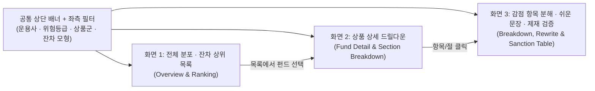

# 대시보드 연결·내보내기 계약·3화면 와이어프레임

펀드·ETF 설명 리스크 대시보드의 연결 방식, 내보내기 파일(`exports/`) 계약, 3화면 와이어프레임 초안, 로컬 파일에서 S3 전환 절차를 정한다.

## 상태

| 항목 | 내용 |
|---|---|
| 상태 | 초안. 연결 방식·저장소 위치·파일 형식·문서 전문 제외·제재 사례표 대체는 11월 28일 PM(대현) 확정. 3화면 와이어프레임과 파트 B 칼럼은 데이터 사이언스(다빈)·데이터 엔지니어링·인프라(주영) 검토 대기 |
| 작성 | PM(대현), 11월 28일 |
| 담당 | 연결·화면 구현: 데이터 엔지니어링·인프라(주영)(11월 28일 재배정), 와이어프레임 확정: 데이터 사이언스(다빈)·PM(대현) |
| 입력 | [파이프라인 아키텍처 초안](architecture.md) 1절·3-2절·8절, signal-infra `docs/storage-design.md` 3.9절, [3단계 입출력 Schema 설계 입력](io-schema.md) 「CDI 출력 요구」, [점수 저장과 비교 모집단](scoring-and-population.md) 「검증」, Project-Management `docs/05-timeline.md` 6·8절 |
| 정하는 것 | 대시보드 호스팅·열람 환경, 코드 저장소 위치, `exports/` Parquet·JSON 계약, 3화면 화면 구성과 필터, 로컬 파일에서 S3 전환 규칙 |
| 정하지 않는 것 | 파트 B(축 1·2) 최종 가중치 값과 민감도 판정 결과(데이터 사이언스(다빈)), 대조군 감사 표본 최종 정밀도 수치(분석·리서치(민석)·데이터 사이언스(다빈)), 쉬운 문장 변환 프롬프트와 모델 선정 |

---

## 1. 연결 방식·저장소·열람 환경 결정 (11월 28일 확정)

| 결정 항목 | 확정 내용 | 근거 |
|---|---|---|
| 연결 방식 | **A'안: Streamlit Community Cloud + S3 내보내기 파일(`exports/`)** | RDS 포트를 인터넷에 열지 않고 무료로 외부 공개·4인 열람 가능. 대시보드는 공식 채점 실행(`is_official = true`) 1건만 읽으므로 실행 단위 내보내기 파일과 맞음(signal-infra `docs/storage-design.md` 3.9절) |
| 선착수 원천 | **로컬 DB 내보내기 파일로 화면 작업 선착수 → AWS S3·RDS 준비 후 원천 경로만 전환** | 11월 28일 기준 AWS RDS·EC2 자원이 없고 12월 10일부터 기말고사 구간이라 서버 구축을 기다리면 화면 작업 기간이 남지 않음(11월 28일 PM 결정). 앱 코드는 환경 변수(`DASHBOARD_DATA_ROOT`)만 바꿔 로컬 폴더와 `s3://` 버킷을 같은 코드로 읽음 |
| 앱 코드 위치 | **`signal-pipeline` 저장소 안 `dashboard/` 폴더** | 기존 3저장소 원칙(`signal-pipeline`·`signal-infra`·`Project-Management`) 유지. `exports/` 계약·CI 검사와 한 저장소에서 동기화 가능. Streamlit Community Cloud 배포 설정에서 진입 파일 경로를 `dashboard/app.py`로 지정 |
| 의존성 분리 | **`dashboard/requirements.txt` 별도 관리** | EC2의 `signal-pipeline` 가상환경(`pyproject.toml`·`uv.lock`)에 Streamlit·Plotly·PyArrow를 넣지 않아 2GB 메모리 한도와 기존 CI(`uv sync --locked`)를 건드리지 않음 |
| 파일 형식 | **Parquet + 메타 JSON** | signal-infra `docs/storage-design.md` 3.9절의 `official.json`·Parquet 트리와 일치. CSV 대비 파일 크기와 로딩 시간이 작고 자료형(정수·실수·불리언·결측)이 유지됨 |
| 문서 전문 포함 여부 | **문서 전문 제외. 드릴다운 필요 칼럼과 근거 인용 문장만 포함** | 문서 전문을 넣으면 500건 기준 수백 MB~GB 규모가 되어 Streamlit Community Cloud 메모리 한도(1GB)를 넘길 위험이 있음. 절 제목·번호와 근거 인용 문장만으로 3화면 완료 조건을 충족함 |
| 열람 범위·안내 문구 | **외부 공개, 읽기 전용** | 11월 25일 PM 결정. 모든 화면 상단에 「자동 판정 결과이며 법적 판단이 아닙니다」 안내와 기준일·대상 건수·한계를 고정 표시. 확인 가능한 사실 문구만 쓰고 「제재 가능성」 같은 추정 표현을 쓰지 않음([3단계 입출력 Schema 설계 입력](io-schema.md) 「CDI 출력 요구」) |
| 분쟁 사례 탐색 뷰 | **범위 제외(컷). 화면 3의 「축 4 제재 사례 검증 표」로 대체** | 11월 28일 PM 결정. 임베딩 저장소 미구축 및 제재 21건 중 투자설명서 기재 관련 0건 확인에 따라 탐색 뷰를 빼고, 법인 단위 비교표와 대조군 감사 정밀도 표를 화면 3에 표시 |
| 잔차 상위 목록 기본 모형 | **모형 B(위험등급 + ETF + 운용사 고정효과) 기본, 모형 A 병기** | 11월 28일 PM 결정. 모형 A 잔차는 문서 양식이 나쁜 운용사에 몰리며, 축 4 실측에서 모형 A $R^2=0.097$ 대비 모형 B $R^2=0.4337$로 운용사 효과가 큼 |

---

## 2. 내보내기 파일(`exports/`) 계약

### 2-1. 디렉터리 구조

로컬 선착수 경로(`../signal-data/exports/dashboard/`)와 운영 S3 버킷 접두어(`s3://<버킷>/exports/`)가 **같은 상대 경로 트리**를 쓴다.

```text
{DASHBOARD_DATA_ROOT}/
├── official.json                              # 현재 공식 실행 포인터 (대시보드가 가장 먼저 읽음)
└── runs/
    └── {score_run_id}/
        ├── dashboard_documents.parquet        # [필수] 펀드 묶음별 요약·잔차·파트 A/B 집계
        ├── axis4_judgments.parquet            # [필수] 문서 × 10항목 고지 판정과 근거 인용
        ├── residual_summary.json              # [필수] 모형 A/B R², 계수, 표본·제외 건수, 입력 해시
        ├── sanction_validation.parquet        # [선택] 운용사별 축 4 제재 대조군 비교표
        ├── sanction_summary.json              # [선택] 법인 단위 음성 결과 요약·대조군 감사 정밀도(12월 2일 확정)
        ├── section_scores.parquet             # [선택] 부·절별 파트 B 점수·감점 사유·쉬운 문장 변환
        └── sensitivity_summary.json           # [선택] 가중치·정규화 민감도 순위 변화 요약(12월 2일 확정)
```

- **공개 식별자 규칙 준수**([스키마 명세](schema-catalog.md) 「공개 식별자 규칙」): `score_id`, `target_key`, `raw_object_id`, 로컬·S3 내부 파일 경로는 어느 내보내기 파일에도 넣지 않는다.
- **불일치 0건 검증**: `dashboard/build_exports.py`는 내보내기 생성 시 `dashboard_documents.parquet`의 항목 개수(`met_count`, `unmet_count`, `undetermined_count`, `na_count`)와 `axis4_judgments.parquet`의 실제 집계를 전수 대조해 1건이라도 다르면 중단한다.

### 2-2. `official.json`

대시보드가 진입 시 가장 먼저 읽는 포인터 파일. 공식 실행이 바뀔 때만 갱신한다.

```json
{
  "contract_version": "dashboard-export-v1",
  "score_run_id": "score-YYYYMMDDTHHMMSSZ-xxxx",
  "baseline_date": "2026-09-29",
  "generated_at": "2026-11-28T17:10:00+09:00",
  "residual_default_model": "model_b",
  "has_part_b": false,
  "has_rewrites": false,
  "has_sanction_audit": false,
  "files": {
    "documents": "runs/{score_run_id}/dashboard_documents.parquet",
    "axis4_judgments": "runs/{score_run_id}/axis4_judgments.parquet",
    "residual_summary": "runs/{score_run_id}/residual_summary.json",
    "sanction_validation": "runs/{score_run_id}/sanction_validation.parquet",
    "sanction_summary": "runs/{score_run_id}/sanction_summary.json",
    "section_scores": "runs/{score_run_id}/section_scores.parquet",
    "sensitivity_summary": "runs/{score_run_id}/sensitivity_summary.json"
  }
}
```

- `files`의 선택 항목 값이 `null`이거나 파일이 없으면 대시보드는 해당 구역에 「데이터 반영 대기」 안내를 표시하고 나머지 화면을 정상 렌더링한다.

### 2-3. `dashboard_documents.parquet` (1행 = 고유 펀드 묶음 1개)

문서 전문을 제외하고 화면 1(목록·분포)과 화면 2(상세 헤더)에 필요한 칼럼만 담는다.

| 칼럼명 | 타입 | 결측 허용 | 출처·의미 |
|---|---|---|---|
| `corp_code` | string | 불가 | DART 운용사 코드 (8자리) |
| `manager` | string | 불가 | 운용사명 |
| `fund_key` | string | 불가 | 펀드 묶음 키(정규화 펀드명 또는 `FGnnnnnn`) |
| `rcept_no` | string | 가능 | 대표 투자설명서 DART 접수번호(14자리). 대표 문서 동률(`AMBIGUOUS_DOCUMENT`)이면 `null` |
| `risk_grade` | int8 | 가능 | 표지 대표 위험등급(1~6, 1이 가장 높은 위험). 외국 엄브렐러 등은 `null` |
| `is_etf` | bool | 불가 | ETF 여부(현재 보고서명 「상장지수」, KRX 매칭 적재 후 KRX 우선) |
| `manager_group_count` | int32 | 불가 | 같은 운용사의 전체 펀드 묶음 수(1개면 모형 B 잔차 0) |
| `axis4_met_count` | int16 | 가능 | 파트 A 「있음」 항목 수 |
| `axis4_unmet_count` | int16 | 가능 | 파트 A 「없음」 항목 수 |
| `axis4_undetermined_count` | int16 | 가능 | 파트 A 「판정 불가」 항목 수 |
| `axis4_na_count` | int16 | 가능 | 파트 A 「적용 대상 아님」 항목 수 |
| `axis4_unmet_ratio` | float64 | 가능 | 없음 ÷ (있음 + 없음). 분모가 0이면 `null` |
| `axis4_fitted_a` | float64 | 가능 | 모형 A(위험등급 + ETF) 적합값 |
| `axis4_residual_a` | float64 | 가능 | 모형 A 잔차(양수일수록 기대보다 누락 많음) |
| `axis4_fitted_b` | float64 | 가능 | 모형 B(+ 운용사 고정효과) 적합값 |
| `axis4_residual_b` | float64 | 가능 | 모형 B 잔차 (**잔차 상위 목록 기본 정렬 기준**) |
| `exclude_reason` | string | 가능 | 회귀 제외 사유(`null`이면 회귀 포함) |
| `part_b_status` | string | 불가 | 파트 B 산출 상태(`OK`, `UNDETERMINED`, `PENDING`) |
| `axis1_raw` | float64 | 가능 | 축 1(언어 복잡도) 원값. 합류 전 `null` |
| `axis2_raw` | float64 | 가능 | 축 2(용어 부담) 원값. 합류 전 `null` |
| `part_b_score` | float64 | 가능 | 파트 B 가중 합산값. 합류 전 `null` |
| `part_b_percentile` | float64 | 가능 | 동일 상품군 × 위험등급 층 내 백분위(0~100). 합류 전 `null` |
| `part_b_grade_5` | int8 | 가능 | 5단계 등급(민감도 미달 대안 발동 시 사용, 11월 28일 PM 결정). 합류 전 `null` |
| `part_b_residual_b` | float64 | 가능 | 파트 B 위험등급·운용사 통제 잔차(모형 B). 합류 전 `null` |

- 파트 A(`axis4_*`)와 파트 B(`part_b_*`)는 칼럼부터 분리하며 대시보드에서도 두 값을 합산하지 않는다.

### 2-4. `axis4_judgments.parquet` (1행 = 대표 문서 × 점검표 10항목)

| 칼럼명 | 타입 | 결측 허용 | 출처·의미 |
|---|---|---|---|
| `rcept_no` | string | 불가 | 대표 투자설명서 접수번호 |
| `item` | string | 불가 | 점검표 항목 코드(`나1`, `나2`, `3.1`, `3.2`, `3.3`, `3.4`, `4.1`, `4.2`, `4.3`, `11.2`) |
| `item_name` | string | 불가 | 항목 한글 명칭(예: 「수수료와 보수」) |
| `legal_basis` | string | 불가 | 금소법 근거 조문(예: 「19조①1호나목4) / 시행령 13조④1호」) |
| `status` | string | 불가 | 판정값(`있음`, `없음`, `판정 불가`, `적용 대상 아님`) |
| `evidence_sections` | string | 가능 | 근거 절 표기(예: 「제2부 13절」) |
| `quote_or_reason` | string | 가능 | 근거 인용 문장 또는 판정 사유(원문 전문 제외, 1,200자 상한 절단 없이 인용 원문 보관) |

### 2-5. `section_scores.parquet` (선택, 축 1·2 및 쉬운 문장 변환 합류 슬롯)

| 칼럼명 | 타입 | 결측 허용 | 출처·의미 |
|---|---|---|---|
| `rcept_no` | string | 불가 | 대표 투자설명서 접수번호 |
| `part_no` | int16 | 가능 | 부 번호(표지·요약은 `null`) |
| `section_no` | int16 | 가능 | 절 번호 |
| `section_title` | string | 불가 | 부·절 제목 |
| `axis1_score` | float64 | 가능 | 절 단위 축 1 점수 |
| `axis2_score` | float64 | 가능 | 절 단위 축 2 점수 |
| `section_percentile` | float64 | 가능 | 동일 층·절 기준 백분위(0~100) |
| `deduction_reason` | string | 가능 | 감점 사유 요약(예: 「긴 문장·미설명 전문용어 상위 10%」) |
| `original_excerpt` | string | 가능 | 쉬운 문장 변환 대상 원문 발췌(제2부 10절·13절 우선) |
| `simplified_text` | string | 가능 | LLM 쉬운 문장 변환 결과(의미 보존 검사 통과 건만 적재) |
| `simplified_percentile` | float64 | 가능 | 변환문을 같은 기준집단에 넣은 재계산 백분위 |
| `llm_acc_before` | float64 | 가능 | 변환 전 LLM 이해도 정답률(0~1) |
| `llm_acc_after` | float64 | 가능 | 변환 후 LLM 이해도 정답률(0~1) |
| `meaning_preserved` | bool | 가능 | 의미 보존 검사 통과 여부(수수료율·등급·원금손실 고지·핵심어 대조. `false` 행은 화면에 표시하지 않음) |

### 2-6. `sanction_validation.parquet` 및 `sanction_summary.json` (선택, 화면 3 제재 검증)

- `sanction_validation.parquet` (1행 = 운용사 1곳, 법인 단위 비교):
  - `manager` (string), `group` (`제재 있음` / `대조군 후보`), `document_count` (int32), `unmet_ratio_3_2`, `unmet_ratio_3_3`, `unmet_ratio_3_4`, `unmet_ratio_4_1`, `unmet_ratio_4_2`, `unmet_ratio_discriminating_5`, `unmet_ratio_all_10` (모두 float64, 결측 허용)
- `sanction_summary.json`:
  - 법인 단위 비교 요약(문서 제출 운용사 제재 21건 중 투자설명서 기재 관련 0건 — 음성 결과 보고)
  - 대조군 감사 표본 정밀도(전체·항목별 정밀도, Wilson 95% 신뢰구간, 판정자 일치율, `판정 불가` 제외 건수 — 12월 2일 확정 후 채움)

---

## 3. 대시보드 3화면 와이어프레임 (초안)

### 3-1. 화면 이동 흐름



### 3-2. 공통 요소 (전 화면 고정)

- **상단 안내 배너**:
  - `자동 판정 결과이며 법적 판단이 아닙니다. 금소법 19조 설명서와 DART 투자설명서는 다른 문서이며, 공모펀드 상품정보 부분을 투자설명서로 대리 판정한 결과입니다.`
  - 메타 한 줄: `기준 실행 · 기준일(최신 접수일) · 분석 펀드 묶음 수 · 모형 B 기본`
- **좌측 사이드바 필터**:
  - 화면 전환(화면 1 / 화면 2 / 화면 3)
  - 상품군(`전체`, `공모펀드`, `ETF`)
  - 위험등급(`1등급` ~ `6등급` 다중 선택)
  - 운용사(다중 선택, 검색 지원)
  - 잔차 모형 선택(`모형 B: 위험등급+ETF+운용사 고정효과(기본)`, `모형 A: 위험등급+ETF`)
  - 회귀 제외 묶음 표시 토글(외국 엄브렐러·대표 문서 동률 등 15건)

### 3-3. 화면 1 — 전체 분포 · 잔차 상위 목록

완료 조건 연결: 3화면 열람 가능, 표시 수치가 잔차 테이블과 일치, 파트 A·B 분리 표시.

```text
+----------------------------------------------------------------------------------+
| [안내 배너] 자동 판정 결과이며 법적 판단이 아닙니다 | 기준일: YYYY-MM-DD | N=474 |
+--------------------+-------------------------------------------------------------+
| [사이드바 필터]     | 화면 1. 전체 분포 및 위험등급 통제 잔차 상위 목록             |
| - 화면 선택        |                                                             |
| - 상품군(펀드/ETF) | [KPI 1] 분석 묶음  [KPI 2] 누락 1건+  [KPI 3] 모형B R² [KPI4]|
| - 위험등급(1~6)    |   474 / 489개        200개 (42.2%)      0.4337      파트B대기|
| - 운용사           |                                                             |
| - 잔차 모형(B/A)   | [차트 좌] 위험등급 × 상품군별       [차트 우] 운용사별 평균   |
| - 제외 묶음 토글   |          없음 비율·잔차 분포                 없음 비율 (상위) |
|                    |                                                             |
|                    | [탭] 파트 A: 고지 충실도 잔차(기본) | 파트 B: 읽기 난이도    |
|                    | ----------------------------------------------------------- |
|                    | 잔차 상위 목록 (모형 B 잔차 내림차순, 모형 A 병기)           |
|                    | 순위 | 운용사 | 펀드 묶음 | 등급 | ETF | 없음비율 | 잔차B | 잔차A |
|                    |  1   | ...    | ...       |  1   | N   | 20.0%    | +0.195| +0.163|
|                    | ...  (CSV 다운로드 버튼 / 펀드 선택 시 화면 2 상세로 이동)   |
+--------------------+-------------------------------------------------------------+
```

- **숫자 일치 규칙**: KPI와 표의 모든 값은 `dashboard_documents.parquet`와 `residual_summary.json`에서만 계산한다. 별도 재회귀를 대시보드 안에서 돌리지 않는다.

### 3-4. 화면 2 — 상품 상세 드릴다운

완료 조건 연결: 부·절별 점수와 감점 사유가 화면에 보임, 축 4 항목별 판정은 읽기 난이도 점수와 따로 표시(합산 금지).

```text
+----------------------------------------------------------------------------------+
| [사이드바]         | 화면 2. 상품 상세 드릴다운                                   |
|                    | [펀드 검색·선택 드롭다운] (화면 1에서 선택한 펀드 자동 연동)   |
|                    |                                                             |
|                    | [메타 카드] 펀드 묶음명 | 운용사 | 접수번호 | 등급 | ETF     |
|                    |             모형 B 잔차(순위) | 모형 A 잔차 | 없음 비율      |
|                    | ----------------------------------------------------------- |
|                    | [구역 A] 파트 A — 금소법 19조 설명의무 10항목 고지 점검      |
|                    |  요약 배지: 있음 N | 없음 M | 판정 불가 K | 적용 대상 아님 J |
|                    |  항목 | 내용 | 근거 조문 | 판정 | 근거 절 | 인용 문장/사유  |
|                    |  3.3  | 위험등급 의미.. | 19조.. | [없음] | 제2부 10절 | (펼치기) |
|                    |  4.1  | 수수료와 보수   | 19조.. | [있음] | 제2부 13절 | (펼치기) |
|                    | ----------------------------------------------------------- |
|                    | [구역 B] 파트 B — 부·절별 읽기 난이도 점수 및 감점 사유      |
|                    |  (파트 A와 합산하지 않음. 축 1·2 합류 시 절별 바 차트 + 표)  |
|                    |  부·절 | 절 제목 | 축 1 | 축 2 | 층 내 백분위 | 감점 사유    |
|                    |  (합류 전: 예정 구조 안내 및 축 1·2 준비 상태 표시)          |
+--------------------+-------------------------------------------------------------+
```

- **표현 규칙**: 「없음」 항목은 「제2부 10절에서 해당 고지 문구를 찾지 못함」처럼 확인 가능한 사실로만 표시한다.

### 3-5. 화면 3 — 감점 항목 분해 · 쉬운 문장 변환 · 축 4 제재 사례 검증

완료 조건 연결: 감점 항목 분해(쉬운 문장 변환 포함, 11월 25일 PM 결정) + 축 4 제재 사례표(분쟁 사례 탐색 뷰 대체, 11월 28일 PM 결정).

```text
+----------------------------------------------------------------------------------+
| [사이드바]         | 화면 3. 감점 항목 분해 · 쉬운 문장 변환 · 제재 사례 검증     |
|                    |                                                             |
|                    | [탭 1] 항목별 누락·감점 분해                                 |
|                    |  - 10항목별 없음 / 판정 불가 비율 가로 막대 차트              |
|                    |  - 운용사 × 항목 없음 비율 히트맵(상위 운용사 기준)           |
|                    |  - 특정 항목 선택 시 「없음」 판정 펀드 목록 + 사유 표        |
|                    |                                                             |
|                    | [탭 2] 쉬운 문장 변환 비교 (제2부 10절 투자위험 · 13절 수수료)|
|                    |  [고정 안내] AI가 만든 참고용 예시이며 법적 효력이 없음       |
|                    |  - 좌: 원문 발췌 (백분위 / LLM 정답률)                        |
|                    |  - 우: 쉬운 문장 변환문 (재계산 백분위 / LLM 정답률)          |
|                    |  - 의미 보존 검사 배지: 수수료율 · 등급 · 원금손실 · 핵심어   |
|                    |    (검사 미통과 변환문은 표시하지 않음)                       |
|                    |                                                             |
|                    | [탭 3] 축 4 제재 사례 검증 표 (분쟁 사례 탐색 뷰 대체)        |
|                    |  - 검증 요약 카드: 운용사 제재 21건 중 기재 관련 0건(음성)    |
|                    |                    + 대조군 감사 정밀도·Wilson 95% CI(12/2)  |
|                    |  - 집단 비교 차트: 제재 있음(15사) vs 대조군 후보(20사)       |
|                    |  - 운용사별 항목별 없음 비율 상세 표(검색·정렬·CSV 다운로드)  |
+--------------------+-------------------------------------------------------------+
```

---

## 4. 로컬 파일에서 S3·RDS 전환 절차

1. **현재(로컬 선착수)**:
   - `dashboard/build_exports.py`가 로컬 내보내기 CSV·JSON(향후 DB `mart` 직접 조회로 확장)에서 `../signal-data/exports/dashboard/` 아래 `official.json`과 Parquet 파일을 생성한다.
   - `DASHBOARD_DATA_ROOT=../signal-data/exports/dashboard`로 Streamlit 앱을 실행한다.
2. **AWS 구축 후(S3 전환)**:
   - SCORE DAG의 게시 작업(작업 4, [파이프라인 아키텍처 초안](architecture.md) 3-2절)이 같은 구조의 파일을 `s3://<버킷>/exports/runs/{score_run_id}/`에 쓰고, 공식 지정 단계(작업 6)에서 `exports/official.json`을 갱신한다.
   - Streamlit Community Cloud 비밀값(`st.secrets`)에 `DASHBOARD_DATA_ROOT = "s3://<버킷>/exports"`와 대시보드 전용 IAM 사용자 키(`exports/*` 읽기 전용)만 설정한다.
   - `dashboard/data_loader.py`가 `s3://` 접두어를 감지해 `boto3`로 같은 파일 트리를 읽으므로 **화면 코드는 바꾸지 않는다.**

---

## 5. 완료 판정 전수 대조 체크리스트 (Week 10)

- [ ] `dashboard_documents.parquet`와 원본 잔차 CSV의 행 수·펀드 묶음별 잔차 B·잔차 A·없음 비율 불일치 0건
- [ ] `axis4_judgments.parquet`에서 집계한 10항목 상태 건수와 `dashboard_documents.parquet` 집계 열 불일치 0건
- [ ] 공개 식별자 규칙 위반 0건(`score_id`, `target_key`, `raw_object_id`, 내부 파일 경로 미노출)
- [ ] 전 화면 상단 안내 문구(자동 판정·법적 판단 아님) 및 쉬운 문장 변환 예시 안내 문구 표시 확인
- [ ] 파트 A(고지 점검)와 파트 B(읽기 난이도) 비합산 원칙 확인
- [ ] 축 4 제재 사례표에 법인 단위 음성 결과와 대조군 감사 정밀도(Wilson 95% 신뢰구간) 반영 확인

---

## 미결

| 질문 | 결정 필요 주체 | 필요 시점 |
|---|---|---|
| 3화면 와이어프레임 세부 항목·필터·파트 B 절별 표 칼럼 확정 | 데이터 사이언스(다빈)·PM(대현) | 12월 2일 |
| 대시보드 외부 공개 시 운용사·펀드 실명 표기 여부(11월 25일 PM 결정 후속 검토) | PM(대현)·팀 전체 | 12월 9일 |
| 파트 B 합류 시 `section_scores.parquet` 생성 주체(축 1·2 채점 스크립트 직접 출력 vs `build_exports.py` 합병) | 데이터 사이언스(다빈)·데이터 엔지니어링·인프라(주영) | 12월 2일 |
| 민감도 미달 대안(축별 점수 병기·5단계 등급) 발동 여부 | 데이터 사이언스(다빈)·PM(대현) | 12월 9일(지표 확정 점검) |
